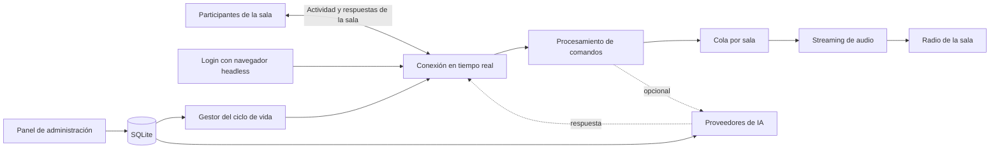
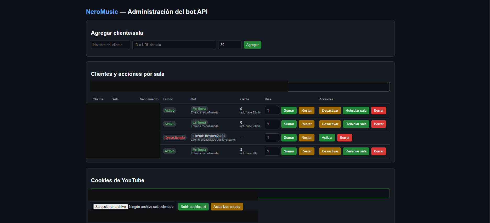
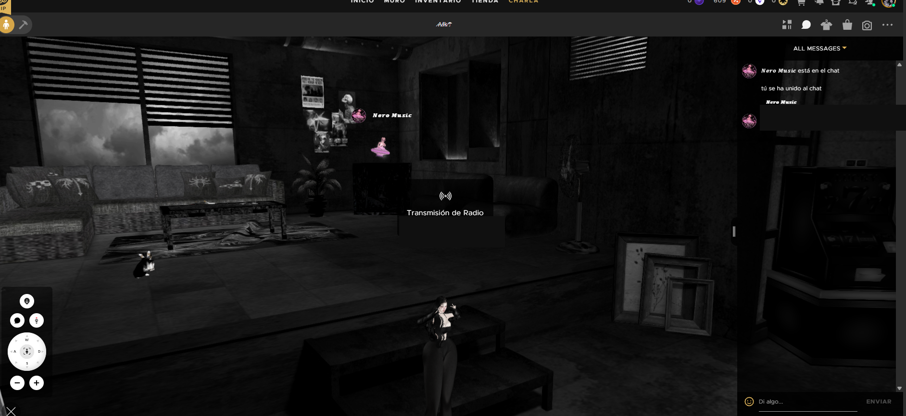
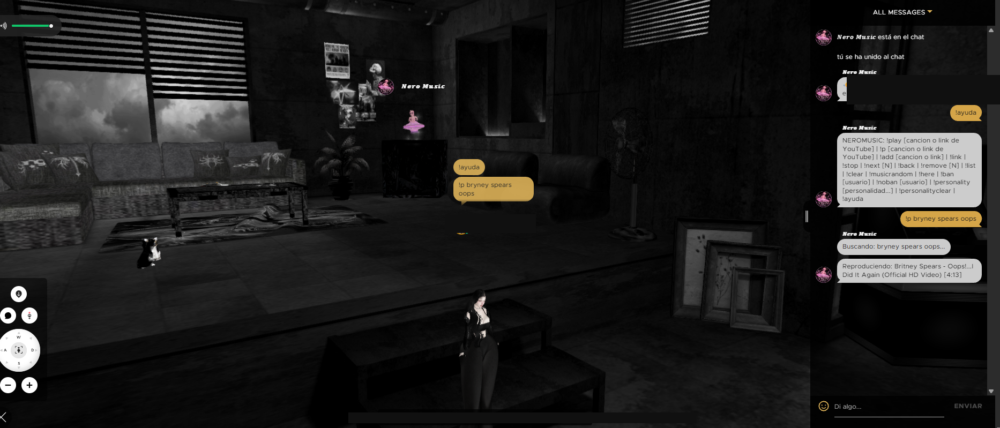

# NeroMusic

Video de demostración: https://youtu.be/AgAS-J0-jnE

NeroMusic es un servicio privado de música multi-cliente para salas de IMVU, con reproducción independiente por sala, administración e IA conversacional opcional bilingüe.

Showcase público: documentación de arquitectura y muestras genéricas con tests. El código fuente del producto es privado.

**Creado por Ezequiel Núñez.** NeroMusic es un proyecto independiente y no está afiliado, respaldado ni patrocinado por IMVU.

## Qué hace

- Recibe comandos del chat para buscar y reproducir pistas solicitadas.
- Mantiene colas y estado del reproductor independientes para cada sala configurada.
- Transmite audio a la radio de la sala mediante un servicio HTTP de audio.
- Ofrece un panel separado para administrar clientes y ajustes de salas.
- Proporciona conversación opcional en español e inglés, configurable por sala.

## Arquitectura de un vistazo

Para ver el [mapa funcional de módulos](docs/module-map.md), el [mapa de comunicación](docs/architecture.md#communication-map), el [modelo de datos](docs/architecture.md#data-model-overview), los [procesos y el despliegue](docs/architecture.md#processes-and-deployment), el [manejo de fallas](docs/architecture.md#failure-handling) y la [hoja de ruta](docs/architecture.md#roadmap-next-steps), consultá las notas de arquitectura.

## Funcionalidades principales

- Gestión multi-sala y multi-cliente.
- Panel separado para agregar, activar, desactivar, reiniciar y eliminar clientes, ajustar períodos del servicio y elegir el idioma de la sala.
- Colas de música por sala, controles de reproducción y radio por streaming.
- Conversación opcional con IA en español e inglés, configuración por sala y hasta tres personalidades configurables.
- Una misma base de código Node.js para Windows y Linux, con resolución de rutas según las herramientas externas disponibles.
- Logs estructurados, verificación de salud del servicio de audio y métricas locales de streaming.

## Capturas

Capturas del producto con identificadores de usuarios, salas y operación redactados.

## Aspectos destacados de ingeniería

- Aplicación modular CommonJS con aproximadamente 34 archivos JavaScript de aplicación.
- Autenticación híbrida: un navegador headless obtiene una sesión válida; luego la aplicación opera mediante WebSocket y REST, con reconexión automática.
- Pipeline de audio: la entrada de `yt-dlp` se convierte a MP3 mediante `ffmpeg` y se sirve por HTTP.
- Una reconciliación periódica compara los clientes deseados en SQLite con las salas activas y gestiona altas, bajas, reintentos y vencimientos.
- La IA es opcional y se puede desactivar por separado; los comandos de música no dependen de proveedores de IA.
- Logs estructurados por evento y una verificación de salud permiten que el proceso principal detecte fallos del servicio de audio e intente recuperarlo.

## En producción

- NeroMusic corre 24/7 en un VPS Ubuntu y la misma base de código también corre en Windows.
- Opciones de despliegue documentadas para Ubuntu: `systemd` con Caddy o Cloudflare Tunnel para publicar el acceso HTTPS al audio.

## Qué contiene y qué no contiene este repositorio

NeroMusic es un producto comercial privado. Aquí no se publica el código de la aplicación, la configuración de despliegue, los datos operativos ni la información de clientes. Este showcase contiene documentación de arquitectura e ingeniería y módulos pequeños y genéricos, escritos desde cero, que demuestran algunos patrones de programación. La licencia MIT de `samples/` no se aplica al producto privado ni a su código fuente.

## Muestras de código

Las tres muestras independientes se escribieron desde cero y muestran patrones de ingeniería reutilizables sin incluir código del producto. La suite actual contiene 21 tests automatizados:

| Muestra                                                       | Qué demuestra                                                        |
| ------------------------------------------------------------- | -------------------------------------------------------------------- |
| [Fallback de proveedores](samples/llm-fallback/README.md)     | Timeouts, reintentos, cancelación, errores tipados y fallback.       |
| [Reconciliador de estado](samples/state-reconciler/README.md) | Convergencia entre estado deseado en SQLite y un adaptador runtime.  |
| [Migraciones SQLite](samples/sqlite-migrations/README.md)     | Migraciones transaccionales, repetibles y seguras ante concurrencia. |

## Herramientas de calidad

Las muestras son JavaScript plano con anotaciones JSDoc. `npm run typecheck` ejecuta `tsc --strict` con `allowJs` y `checkJs`, de modo que los tipos de JSDoc se verifican sin emitir código ni distribuir TypeScript. ESLint y Prettier aplican estilo y formato, y la CI ejecuta lint, chequeo de tipos, formato, tests y auditoría de dependencias de producción en Node.js 20.19 y 22. `tsconfig.json` existe solo para configurar ese chequeo de tipos basado en JSDoc; no es un árbol de fuentes TypeScript. La barra de lenguajes de GitHub informa JavaScript porque todos los archivos de muestra versionados son `.js`, y `tsconfig.json` no cambia esa clasificación.

## Cómo lo desarrollé

Desarrollé NeroMusic con asistencia de IA bajo mi dirección. Concebí el producto, investigué opciones de implementación, definí y aprobé las decisiones de diseño, revisé y corregí la implementación, y me ocupé de las pruebas funcionales, el despliegue y la operación. El producto se validó mediante pruebas funcionales manuales en salas reales. Las pruebas automatizadas de este repositorio cubren únicamente los módulos de ejemplo independientes, no NeroMusic.

## Stack tecnológico

| Área                        | Tecnología                                                         |
| --------------------------- | ------------------------------------------------------------------ |
| Runtime                     | Node.js, CommonJS                                                  |
| Persistencia                | SQLite con `better-sqlite3`                                        |
| Comunicación en tiempo real | WebSocket; REST para operaciones complementarias                   |
| Preparación de sesión       | Puppeteer con navegador headless, utilizado para el login          |
| Audio                       | `yt-dlp`, `ffmpeg`, streaming HTTP                                 |
| IA                          | Cascada opcional de proveedores con configuración por sala         |
| Operación                   | Ubuntu, `systemd`, Caddy o Cloudflare Tunnel; soporte para Windows |
| Samples del showcase        | Módulos nativos de Node.js, `node:test` y `better-sqlite3`         |
