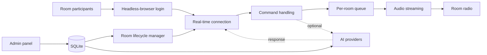

# NeroMusic

NeroMusic is a private, multi-tenant music service for IMVU rooms, with per-room playback, administration, and optional bilingual conversation.  · [Demo video](<COMPLETAR: demo video URL>)

## What it does

- Accepts chat commands to search for and play requested tracks.
- Keeps playback queues and player state independent for each configured room.
- Streams audio to a room's radio through an HTTP audio service.
- Provides a separate control panel for client and room settings.
- Offers optional Spanish/English AI conversation, independently configurable per room.

## Architecture at a glance

## Key features

- Multi-room, multi-client lifecycle management.
- A separate admin panel to add, activate, deactivate, restart, and remove clients, adjust service periods, and choose a room language.
- Per-room music queues, playback controls, and radio streaming.
- Optional Spanish/English AI conversation, per-room settings, and up to three configurable personalities.
- One Node.js codebase for Windows and Linux, with platform-aware paths for external tools.
- Structured logs, an audio-service health check, and local streaming metrics.

## Engineering highlights

- Modular CommonJS application with roughly 34 JavaScript application files.
- Hybrid authentication: a headless browser obtains a valid session; the application then uses WebSocket and REST connections with automatic reconnection.
- Audio pipeline: `yt-dlp` input is converted by `ffmpeg` to MP3 and served over HTTP.
- Periodic reconciliation compares desired room clients in SQLite with active rooms, handling additions, removals, retries, and expirations.
- AI is optional and can be disabled independently; music commands do not depend on an AI provider.
- Structured event logging and a health check allow the main process to detect audio-service failures and attempt recovery.

## In production

- Reported operation: 24/7 on an Ubuntu VPS, with the same codebase also running on Windows.
- Deployment options documented for Ubuntu: `systemd` with either Caddy or Cloudflare Tunnel for public HTTPS audio access.
- Concurrent rooms, customers, and users: [COMPLETAR: verified production counts].
- Production start date: [COMPLETAR: date].
- Measured availability or uptime: [COMPLETAR: measurement period and source].

## What this repo contains / what it doesn't

NeroMusic is a commercial, private product. Its application source, deployment configuration, operational data, and customer information are not published here. This showcase contains architecture and engineering documentation plus small, generic modules written from scratch to demonstrate selected programming patterns. `samples/` is MIT-licensed; that license does not apply to the private product or its source.

## How I built it

I developed NeroMusic with AI assistance under my direction. I conceived the product, researched implementation options, defined and approved the design decisions, reviewed and corrected the implementation, and handled functional testing, deployment, and operation. The product was validated through manual functional tests in real rooms. Automated tests in this repository cover only the independent sample modules, not NeroMusic itself.

## Tech stack

| Area                    | Technology                                                     |
| ----------------------- | -------------------------------------------------------------- |
| Runtime                 | Node.js, CommonJS                                              |
| Persistence             | SQLite with `better-sqlite3`                                   |
| Real-time communication | WebSocket; REST for supporting operations                      |
| Session setup           | Puppeteer with a headless browser, used for login              |
| Audio                   | `yt-dlp`, `ffmpeg`, HTTP streaming                             |
| AI                      | Optional provider cascade with per-room configuration          |
| Operations              | Ubuntu, `systemd`, Caddy or Cloudflare Tunnel; Windows support |
| Showcase samples        | Node.js built-ins, `node:test`, and `better-sqlite3`           |

## Contact

- GitHub: [COMPLETAR: profile URL]
- LinkedIn: [COMPLETAR: profile URL]
- Email: [COMPLETAR: contact email]
