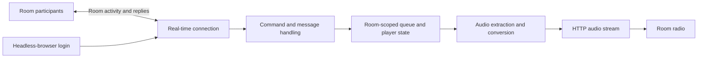
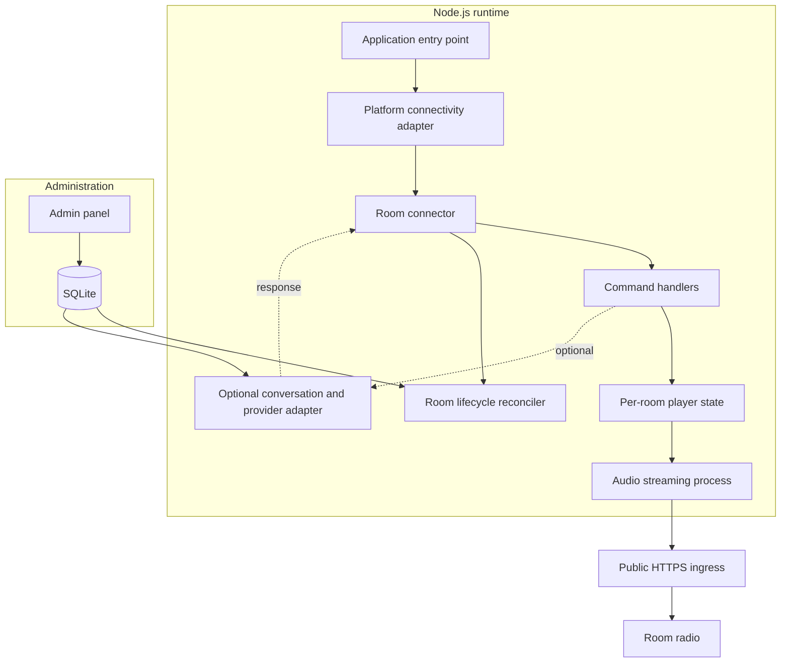
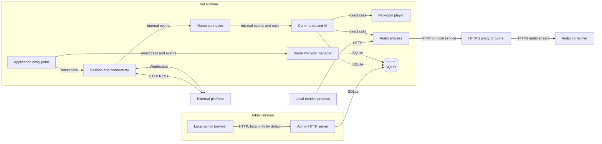
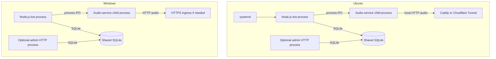

# Architecture

NeroMusic is a modular Node.js application. The product source is private and is not included in this repository. This document describes the system's responsibilities, communication, and operational behavior at a high level.

## End-to-end flow

The headless browser is used during session setup rather than as the long-running room transport. The application then communicates over real-time and REST connections and reconnects when the live connection is interrupted. Room activity is dispatched to command handling, which coordinates room-scoped player state. Audio is made available over HTTP for the room radio.

## Components and control plane

### Responsibilities

- **Application entry point:** starts and shuts down services and coordinates session, rooms, player, and administration.
- **Connectivity and room adapter:** establishes the runtime connection and turns room activity into application events.
- **Command handlers and player state:** validate user actions and keep queues independent by room.
- **Audio streaming process:** converts and distributes the current audio stream independently of chat command handling.
- **Lifecycle reconciler:** periodically compares configured clients in SQLite with active rooms; it handles enrollment, removal, retry, and expiration.
- **Admin panel:** changes persisted client and room settings; the lifecycle manager observes those changes.
- **Optional AI:** consumes eligible conversation events and returns a response through the room connector. The music path does not require it.
- **HTTPS ingress:** exposes the audio service over HTTPS in hosted deployments; the administration panel and operational metrics are local-only by default.

## Module map

See the [functional module map](module-map.md) for a high-level inventory of the runtime components and how they communicate.

## Communication map

The diagram distinguishes internal calls and events, platform connectivity, HTTP listeners, and the shared SQLite state.

The administration server is local-only by default, and its bind address can be configured. The audio service is an HTTP listener in a child process. The application process supervises it and checks its local health endpoint.

## Data model overview

SQLite is the shared source of persisted configuration and operational state for the bot and administration process. The main entities are:

- **Clients:** client and room activation, service period, and operational status.
- **Room bans:** restrictions associated with a user in a room.
- **Bot status:** process state and heartbeat used by administration.
- **Room AI settings:** whether conversational AI is enabled and which language is used.
- **Room personalities:** the configurable personality set assigned to a room.
- **AI memories:** time-limited conversational memories scoped to a room and user.
- **Room-user relations:** relationship state maintained per room and user.

Playback queues, active streams, and conversational work coordination also use in-memory state. They are reconstructed or refreshed through runtime control paths and are not represented as a persisted queue in this overview.

## Processes and deployment

The application is a CommonJS Node.js bot process with a separate audio-service child process. The administration server can run as a separate Node.js process or start within the bot process when configured; it is local-only by default. Local metrics are an optional separate process.

- **Ubuntu:** the bot runs under `systemd`. Caddy or Cloudflare Tunnel can provide HTTPS ingress to the local audio service. The administration panel is local-only by default.
- **Windows:** the same CommonJS codebase runs under Node.js; the bot and optional standalone panel can be launched as Node.js processes. A compatible HTTPS ingress is needed when audio must be reachable outside the machine.
- **Audio process:** the bot starts and monitors the audio service as a child process. Repeated health-check failures trigger a restart attempt and restoration of active streams.
- **Platform-aware paths:** runtime path resolution accepts explicit paths, checks for a local executable using the current platform's executable suffix, and otherwise resolves a command through the operating system's path lookup. Browser resolution is handled separately using configured paths or platform-specific common locations.

## Failure handling

- **Expired or rejected session:** the system recovers by renewing the session after authentication failures or exhausted connection retries. When renewed, it rebuilds the connection, rejoins active rooms, and resumes their current tracks where possible; renewal is retried after a delay when needed.
- **Interrupted real-time connection:** the connection adapter retries using configured delays, and the room connector attempts to restore room participation. The lifecycle manager can reconcile a room again when a rejoin is unsuccessful.
- **Unavailable AI provider:** the system continues through configured providers when a call fails or returns unusable content. Music playback remains available independently of AI responses.
- **Audio extraction or conversion failure:** command handling tries available alternatives and then the next queued track where applicable. When recovery is exhausted, the system switches that room to silence and records the failure.
- **Room interruption or expiration:** the room connector attempts to restore interrupted room participation, while the lifecycle manager removes rooms that are no longer active or eligible and retries failed joins during later reconciliations.
- **Audio process failure:** after repeated health-check failures, the main process restarts the child process and attempts to restore streams for connected rooms.

## Roadmap / Next steps

These are potential improvements that build on the current design:

1. Add automated integration tests for room lifecycle, playback recovery, and session-independent application behavior.
2. Introduce TypeScript gradually around stable module boundaries while preserving the existing runtime.
3. Build a metrics dashboard with configurable operational alerts.
4. Extend CI/CD to validate and support controlled deployment workflows.
