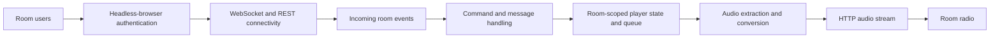
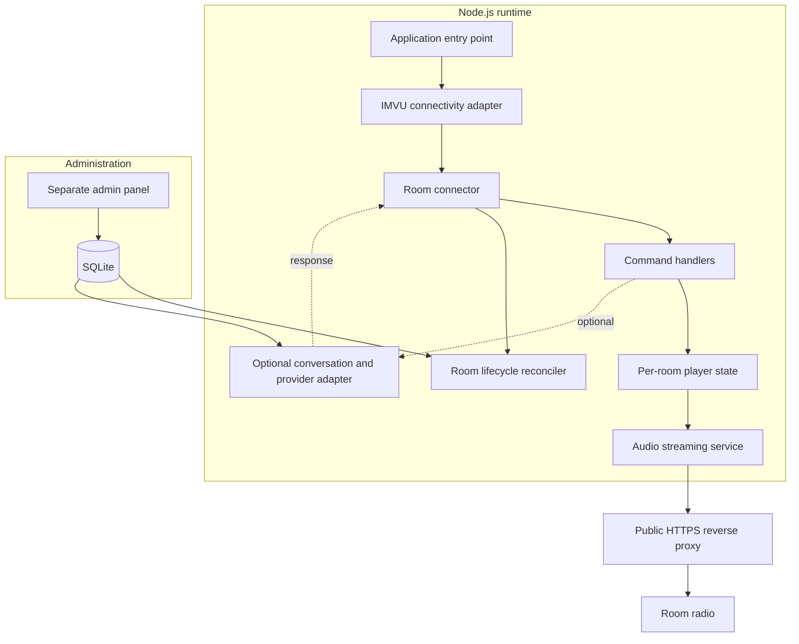

# Architecture

NeroMusic is a modular Node.js application. The product source is private and is not included in this repository; this description stays at a conceptual level.

## End-to-end flow

The browser is used during session setup rather than as the long-running room transport. The application then communicates over WebSocket and REST and reconnects when the live connection is interrupted. Room events are dispatched to command handling, which coordinates room-scoped player state. Audio is made available over HTTP for the room radio.

## Components and control plane

### Responsibilities

- **Application entry point:** starts and shuts down services and coordinates session, rooms, player, and administration.
- **Connectivity and room adapter:** establishes the runtime connection and turns room events into application events.
- **Command handlers and player state:** validate user actions and keep queues independent by room.
- **Audio streaming service:** converts and distributes the current audio stream independently of chat command handling.
- **Lifecycle reconciler:** periodically compares configured clients in SQLite with active rooms; it handles enrollment, removal, retry, and expiration.
- **Admin panel:** changes persisted client and room settings; the lifecycle manager observes those changes.
- **Optional AI:** consumes eligible conversation events and returns a response through the room connector. The music path does not require it.
- **Reverse proxy:** exposes the audio service over HTTPS in hosted deployments; the panel and operational metrics are intended to remain local.

## Runtime and platform model

The application uses CommonJS modules and one Node.js codebase across Windows and Linux. A shared path resolver selects a configured executable, a local platform-specific binary, or a command available on `PATH`. Chrome/Chromium is resolved separately for login. Runtime settings are supplied through environment configuration, not hardcoded deployment-specific source files.

The production layout uses an embedded SQLite database and an HTTP audio service. On Ubuntu, the deployment notes documents `systemd` and either Caddy or Cloudflare Tunnel as alternatives for HTTPS ingress.
