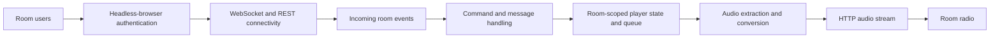
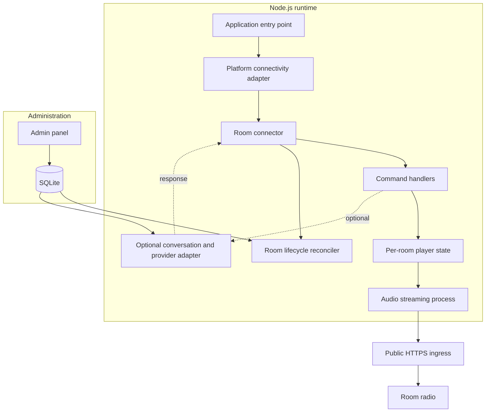
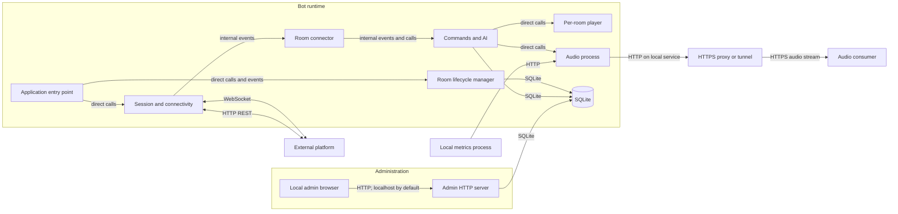
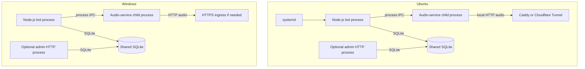

# Architecture

NeroMusic is a modular Node.js application. The product source is private and is not included in this repository. This document describes system responsibilities and communication at a high level.

## End-to-end flow

The browser is used during session setup rather than as the long-running room transport. The application then communicates over WebSocket and REST and reconnects when the live connection is interrupted. Room events are dispatched to command handling, which coordinates room-scoped player state. Audio is made available over HTTP for the room radio.

## Components and control plane

### Responsibilities

- **Application entry point:** starts and shuts down services and coordinates session, rooms, player, and administration.
- **Connectivity and room adapter:** establishes the runtime connection and turns room activity into application events.
- **Command handlers and player state:** validate user actions and keep queues independent by room.
- **Audio streaming process:** converts and distributes the current audio stream independently of chat command handling.
- **Lifecycle reconciler:** periodically compares configured clients in SQLite with active rooms; it handles enrollment, removal, retry, and expiration.
- **Admin panel:** changes persisted client and room settings; the lifecycle manager observes those changes.
- **Optional AI:** consumes eligible conversation events and returns a response through the room connector. The music path does not require it.
- **HTTPS ingress:** exposes the audio service over HTTPS in hosted deployments; the administration panel and operational metrics are intended to remain local.

## Module map

The table lists the runtime modules relevant to the public architecture overview from the application root, `api/`, and `db/`. It describes responsibilities and channels, not internal APIs. 

| Module                 | Responsibility                                                                       | Communicates with                                                                      | How                                                            |
| ---------------------- | ------------------------------------------------------------------------------------ | -------------------------------------------------------------------------------------- | -------------------------------------------------------------- |
| `api/index.js`         | Starts services, wires room events, and coordinates shutdown and recovery.           | Session, room, command, audio, admin, and lifecycle modules.                           | Direct calls; internal events; HTTP health check; process IPC. |
| `Session module`       | Obtains and renews the runtime session using a headless browser for login.           | Application entry point and browser runtime.                                           | Direct calls; internal events.                                 |
| `Real-time connection module`           | Manages the platform's real-time connection.                                         | Remote platform; room connector; application entry point.                              | WebSocket; internal events.                                    |
| `Platform REST client`       | Provides supporting platform operations.                                             | Remote platform; commands and room connector.                                          | HTTP (REST); direct calls.                                     |
| `api/room.js`          | Manages room participation and translates incoming activity into application events. | Real-time adapter, commands, player, and audio service.                                | WebSocket-backed events; internal events; direct calls.        |
| `api/commands.js`      | Routes music and room commands and coordinates playback actions.                     | Room connector, player, search, radio, settings, and audio modules.                    | Direct calls; internal events.                                 |
| `Audio source search`       | Finds audio candidates and related track information for playback.                   | Search service and command handlers.                                                   | HTTP through a library; direct calls.                          |
| `api/radio.js`         | Coordinates room radio playback state and stream selection.                          | Platform radio controls and audio service.                                             | HTTP (REST); direct calls.                                     |
| `api/ai.js`            | Orchestrates optional conversational behavior and its supporting modules.            | Room events, conversation, guardrails, provider, memory, relation, and player modules. | Internal events; direct calls; HTTP through providers.         |
| `api/aiGuard.js`       | Applies runtime guardrails to conversational processing.                             | AI orchestration and conversation handling.                                            | Direct calls.                                                  |
| `api/aiRuntime.js`     | Tracks and cancels per-room conversational work.                                     | AI orchestration and conversation state.                                               | Direct calls.                                                  |
| `api/conversation.js`  | Manages conversational state and response processing.                                | AI orchestration and runtime coordination.                                             | Direct calls.                                                  |
| `api/providers.js`     | Tries configured AI providers and returns a usable response when available.          | External AI services and AI orchestration.                                             | HTTP; direct calls.                                            |
| `api/memory.js`        | Reads and updates room-scoped conversational memories.                               | SQLite and AI orchestration.                                                           | SQLite; direct calls.                                          |
| `api/personalities.js` | Reads and updates configurable conversational personalities.                         | SQLite and AI orchestration.                                                           | SQLite; direct calls.                                          |
| `api/relations.js`     | Reads and updates room-scoped user relationship state.                               | SQLite and AI orchestration.                                                           | SQLite; direct calls.                                          |
| `api/roomSettings.js`  | Reads and updates per-room language and AI settings.                                 | SQLite, commands, and AI modules.                                                      | SQLite; direct calls.                                          |
| `api/bans.js`          | Reads and updates room-scoped participation restrictions.                            | SQLite and command handling.                                                           | SQLite; direct calls.                                          |
| `api/i18n.js`          | Supplies localized user-facing text.                                                 | Commands, room settings, and AI modules.                                               | Direct calls.                                                  |
| `admin-panel.js`       | Serves the administration interface and its control operations.                      | Local browser, SQLite, and local status/control services.                              | HTTP; SQLite; direct calls.                                    |
| `admin.js`             | Provides command-line client administration.                                         | SQLite.                                                                                | Direct calls; SQLite.                                          |
| `botStatus.js`         | Publishes process status and heartbeat information.                                  | SQLite and admin panel.                                                                | SQLite; direct calls.                                          |
| `logger.js`            | Records structured operational events.                                               | Runtime modules.                                                                       | Direct calls.                                                  |
| `musicServer.js`       | Runs the HTTP audio service and manages extraction, conversion, and stream state.    | Main process, local media tools, and HTTP clients.                                     | Process IPC; HTTP; child processes.                            |
| `player.js`            | Maintains in-memory queues and playback state per room.                              | Commands, room connector, and audio service.                                           | Direct calls.                                                  |
| `roomManager.js`       | Reconciles desired client state in SQLite with active room participation.            | SQLite, application entry point, and room connector.                                   | SQLite; direct calls; internal events.                         |
| `runtimePaths.js`      | Resolves platform-specific executable paths.                                         | Application modules and local environment.                                             | Direct calls; operating-system process lookup.                 |
| `streamMetrics.js`     | Collects and prints local audio-service metrics.                                     | Audio service.                                                                         | HTTP; direct calls.                                            |
| `db/database.js`       | Opens the shared SQLite database and ensures required structures exist.              | Modules that persist client, room, or AI state.                                        | SQLite; direct calls.                                          |
| `package.json`         | Defines the Node.js runtime, dependencies, and process entry points.                 | Node.js and the application launchers.                                                 | Direct process invocation.                                     |

`api/` groups the runtime's platform, room, command, and optional AI modules. `db/` contains the SQLite access module. Deployment helpers and development launchers are covered below rather than treated as runtime modules. Session handling remains at the permitted conceptual level; no session-material storage details are published.

## Communication map

The diagram distinguishes internal calls and events, platform connectivity, HTTP listeners, and the shared SQLite state. It intentionally does not show protocol payloads or platform-specific connection details.

The admin server binds to `local-only by default` by default; its bind address is configurable, so the public deployment guidance keeps it local. The audio service is an HTTP listener in a child process. The application process supervises it and checks its local health endpoint.

## Data model overview

SQLite is the shared source of persisted configuration and operational state for the bot and administration process. The main entities are:

- **Clients:** client and room activation, service period, and operational status.
- **Room bans:** restrictions associated with a user in a room.
- **Bot status:** process state and heartbeat used by administration.
- **Room AI settings:** whether conversational AI is enabled and which language is used.
- **Room personalities:** the configurable personality set assigned to a room.
- **AI memories:** time-limited conversational memories scoped to a room and user.
- **Room-user relations:** relationship state maintained per room and user.

Playback queues, active streams, and conversational work coordination also use in-memory state. They are reconstructed or refreshed through runtime control paths and are not represented as a persisted queue in this overview.

## Processes and deployment

The application is a CommonJS Node.js bot process with a separate audio-service child process. The administration server can run as a separate Node.js process or start within the bot process when configured; it is bound to localhost by default. Local metrics are an optional separate process.

- **Ubuntu:** the deployment unit runs the bot entry point under `systemd`. Caddy or Cloudflare Tunnel can provide HTTPS ingress to the local audio service. The administration panel is local by default.
- **Windows:** the same CommonJS codebase runs under Node.js; the bot and optional standalone panel can be launched as Node.js processes. A compatible HTTPS ingress is needed when audio must be reachable outside the machine.
- **Audio process:** the bot starts and monitors the audio service as a child process. A failed health check triggers a restart attempt and restoration of active streams.
- **Platform-aware paths:** `runtimePaths` accepts explicit paths, checks for a local executable using the current platform's executable suffix, and otherwise resolves a command through the operating system's path lookup. Browser resolution is handled separately using configured paths or platform-specific common locations.

## Failure handling

- **Expired or rejected session:** an authentication failure or exhausted real-time reconnect attempts triggers session renewal. If renewal fails, the bot logs the failure and schedules another attempt after a delay. After renewal, it rebuilds the connection, rejoins active rooms, and resumes their current tracks where possible.
- **Interrupted real-time connection:** the connection adapter retries using configured delays. After authentication resumes, the room connector attempts to restore room participation. A room that cannot be rejoined is marked disconnected/error and is eligible for the lifecycle manager's later reconciliation.
- **Unavailable AI provider:** the provider module proceeds to the next configured provider when a call fails or returns empty or invalid content. If no provider returns a usable response, the AI path has no response to send; music playback remains independent.
- **Audio extraction or conversion failure:** the audio process reports a track failure. Command handling tries available alternatives and then the next queued track where applicable; when recovery is exhausted, it switches that room to silence and records the failure.
- **Room interruption or expiration:** temporary room disconnections are reported as reconnecting while the room connector attempts recovery. The lifecycle manager checks whether a client is still active and within its service period, removes rooms that are no longer eligible, and retries failed joins during later reconciliations.
- **Audio process failure:** the main process checks the local health endpoint periodically. After repeated failed checks, it restarts the child process and attempts to restore streams for connected rooms.

## Limitations

- The bot was validated with manual functional tests in real rooms; the automated tests in this repository cover only the independent sample modules.
- The runtime is CommonJS JavaScript rather than TypeScript.
- Session setup uses a headless browser; this remains a part of the current login flow.

## Roadmap and next steps

These are potential improvements, not claims about functionality already delivered:

1. Add automated integration tests for room lifecycle, playback recovery, and session-independent application behavior.
2. Introduce TypeScript gradually around stable module boundaries while preserving the existing runtime.
3. Build a metrics dashboard with configurable operational alerts.
4. Extend CI/CD to validate and support controlled deployment workflows.
